<p align="center">
  <picture>
    <source media="(prefers-color-scheme: dark)" srcset="assets/logo/claimback-logo-dark.svg">
    
  </picture>
</p>

<p align="center"><b>Your loan records, made clear.</b> · 빌려준 돈의 기록을, 더 명확하게.</p>

# ClaimBack My Money (클레임백 마이 머니)

> **Meta Global AI Developer Hackathon 2026 — Build for Your World**
> A free self-help tool that organizes your own evidence for an unpaid personal loan and fills standard Korean court-document text with facts you confirm. The project and engine name is ClaimBack-AI. See the notice below.

2026-11-02 기준 코드(커밋 76d9cce까지)는 대회 기간에 저장소 소유자가 작성했고, 2026-11-03 M-1부터 INT-3b까지는 Muse Code(`muse-spark-1.3`)가 구현하고 Claude Code가 명세·지시·리뷰했다. 같은 날 저녁 INT-3c부터(마무리 수정, 포털 화면, 영어 화면)는 사용자 요청으로 Claude Code가 직접 구현하고 서브에이전트 두 개가 교차 리뷰했다.

Code up to 2026-11-02 (through commit 76d9cce) was written by the repository owner during the hackathon. From 2026-11-03 (milestone M-1) through INT-3b, Muse Code (`muse-spark-1.3`) implemented the changes while Claude Code wrote the specs and task briefs and reviewed each milestone. From INT-3c that evening (final fixes, the portal screen, the English screen), Claude Code implemented the changes directly at the owner's request, with two subagent reviewers cross-checking each one.

---

## Demo video

[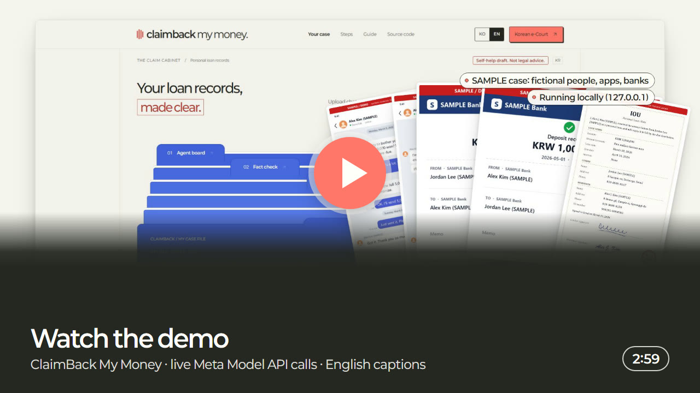](https://www.youtube.com/watch?v=n8cqk2ZI_Xw)

- 2:59, English narration and captions. It opens with a card showing the service name, a one-line description, the repo URL, a contact e-mail, and one line on what was built during the hackathon and what existed before. The screen was recorded on live Meta Model API calls (34 calls, $0.1887 on the cost ledger) with synthetic English SAMPLE evidence (`submission/demo-evidence/`).
- **Watch on YouTube:** https://www.youtube.com/watch?v=n8cqk2ZI_Xw (no sign-in needed; chapters in the description).
- Mirror: https://himangga01.github.io/claimback-ai/demo/claimback-demo.mp4 (the same file, served by GitHub Pages from `docs/`).
- File in this repo: [`docs/demo/claimback-demo.mp4`](docs/demo/claimback-demo.mp4) (1920×1080, 52 MB; GitHub's file view offers it as a download), captions [`docs/demo/claimback-demo.srt`](docs/demo/claimback-demo.srt).
- How it was made (Remotion, a Voicebox narration voice, music and sound effects synthesized in code, no third-party audio): [`submission/demo-video-production.md`](submission/demo-video-production.md).

## Screenshots

The screen in English (`?lang=en`) running the Korean sample case in replay mode. Case content and the court documents stay Korean because they are filed in Korean courts. All people, apps and banks are fictional (SAMPLE).

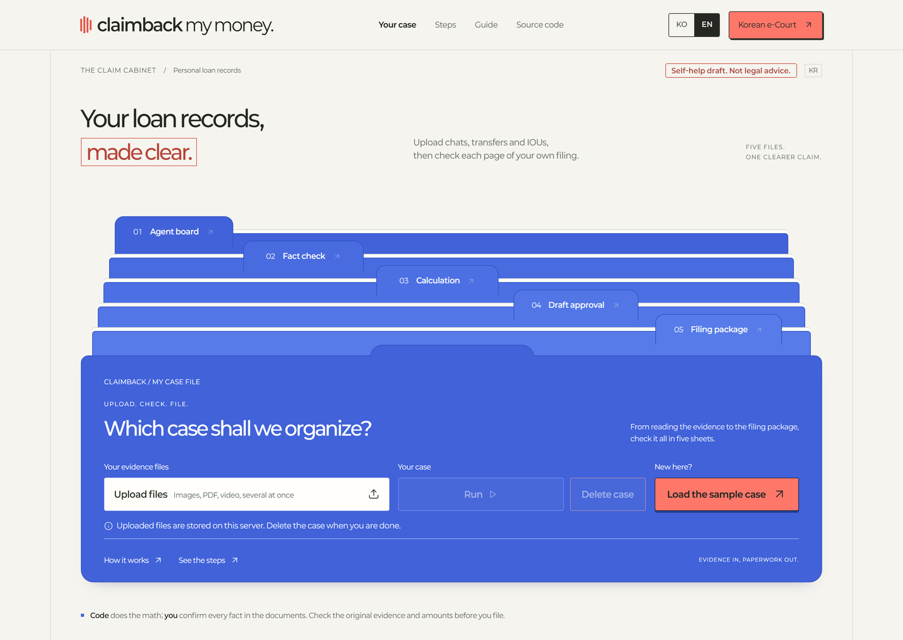
**Start.** Upload your evidence or load the sample case.

| | |
|---|---|
| 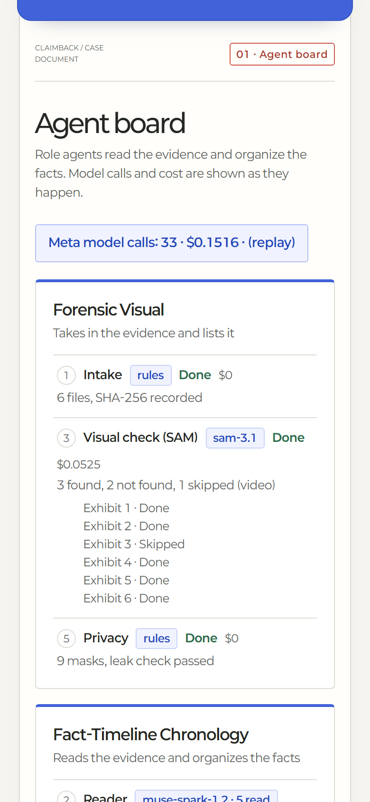<br>**Agent board** (phone width). Role agents work through the files; model calls and cost are shown as they happen. | 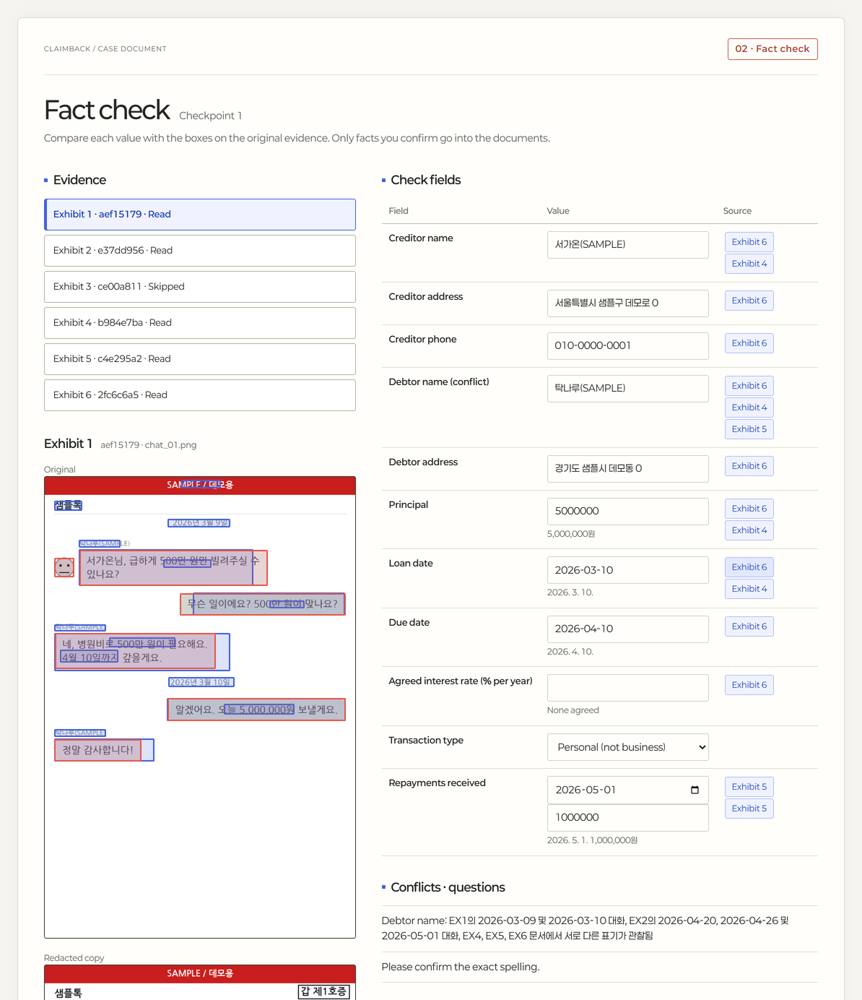<br>**Checkpoint 1: fact check.** Reading boxes (Spark) and found areas (SAM) on the original; each value read from the evidence shows the exhibits it came from. |
| 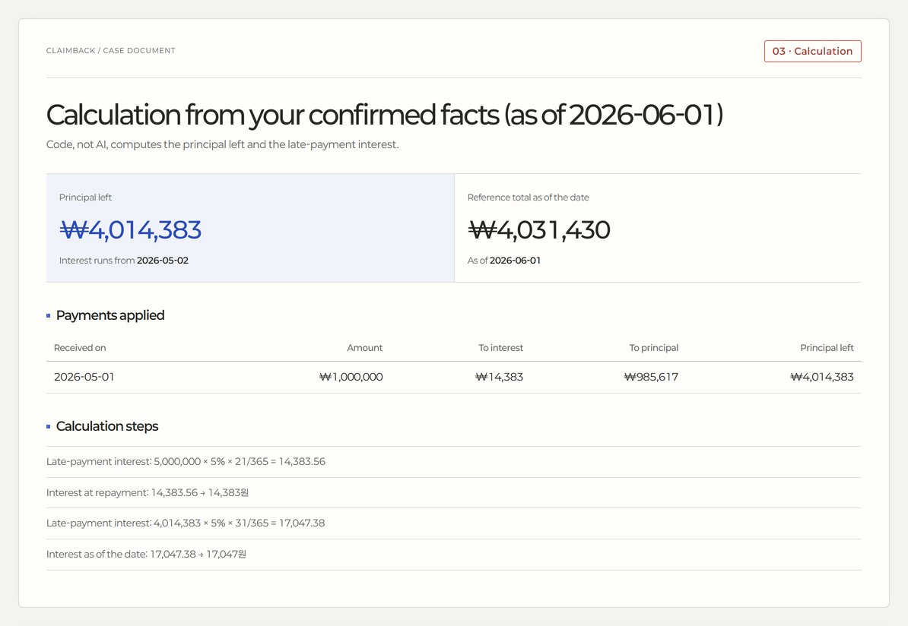<br>**Calculation.** How the repayment was split between interest and principal, by deterministic code. | 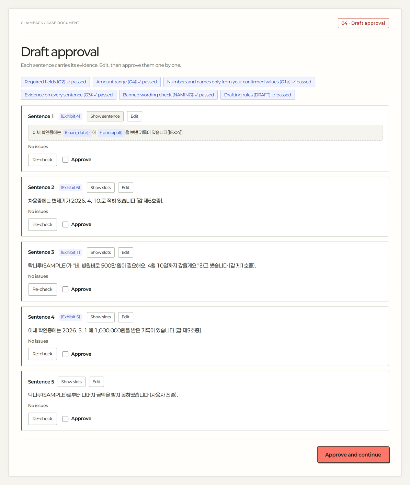<br>**Draft approval.** Fact sentences written with slots and evidence tags; you approve each one. |
| 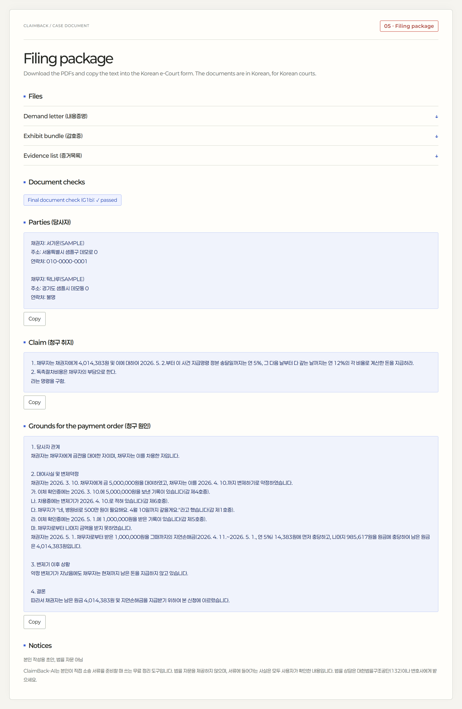<br>**Filing package.** Three PDFs, the payment-order text to paste, and the final check (G1b) against your confirmed values. | 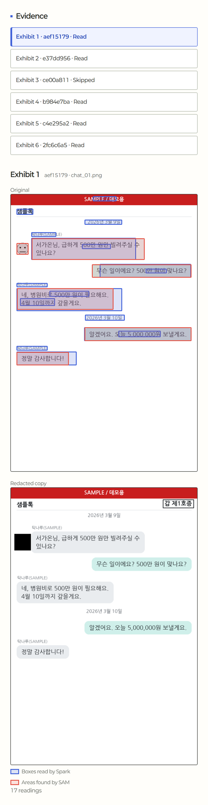<br>**Exhibit 1.** The original with reading boxes, then the redacted copy (profile picture masked). |

Generated documents from the English demo case in the video (a second SAMPLE case):

| | |
|---|---|
| 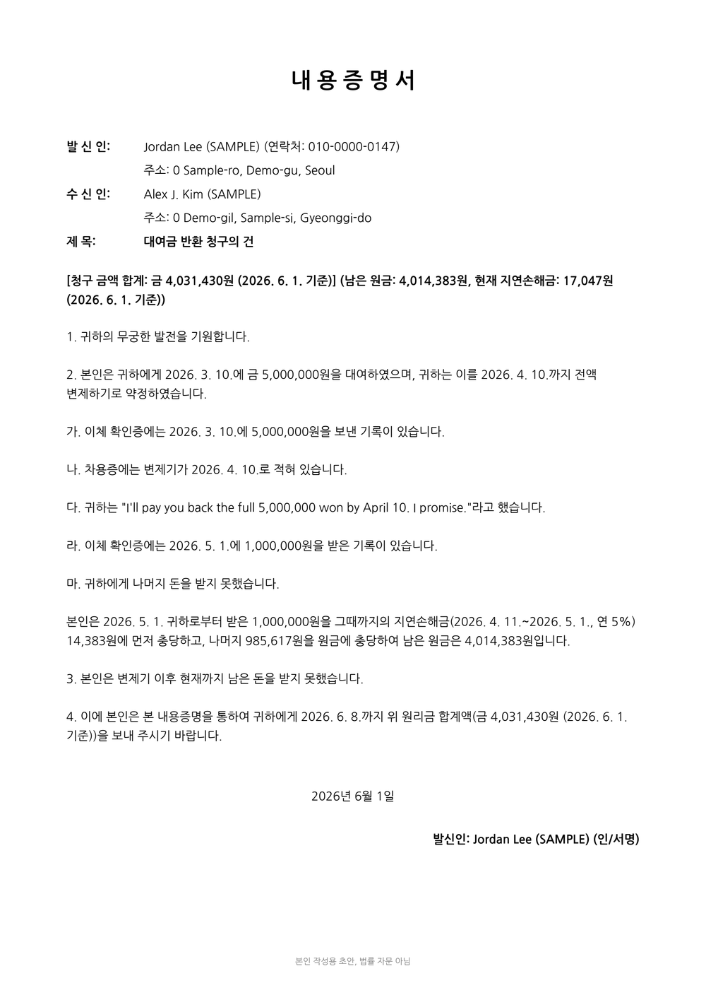<br>**내용증명 (demand letter)**, page 1. | 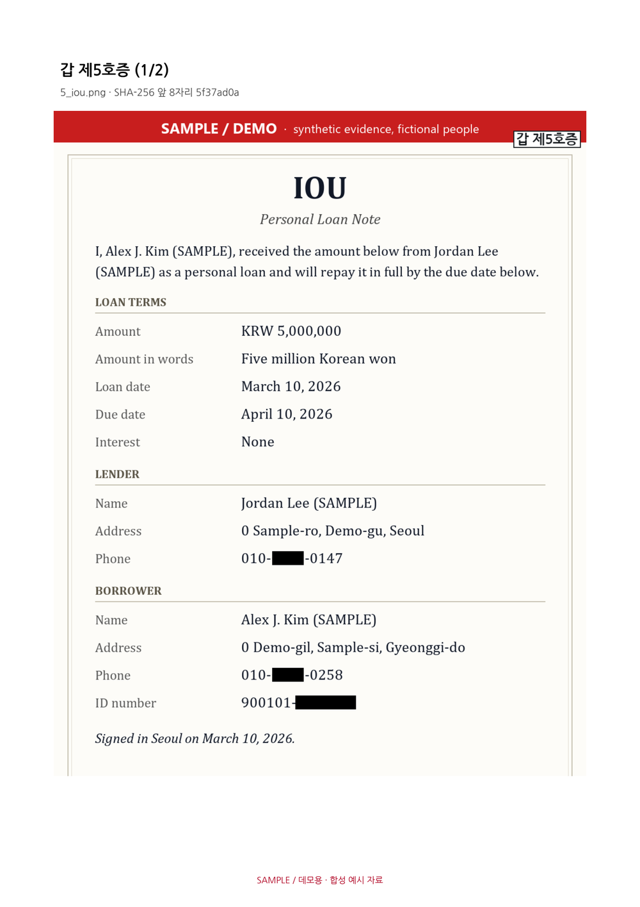<br>**갑 제5호증 (exhibit), the IOU.** The middle digits of both phone numbers and the back half of the ID number are burned out of the image pixels before the PDF is built. |

<details>
<summary>The Korean screen</summary>

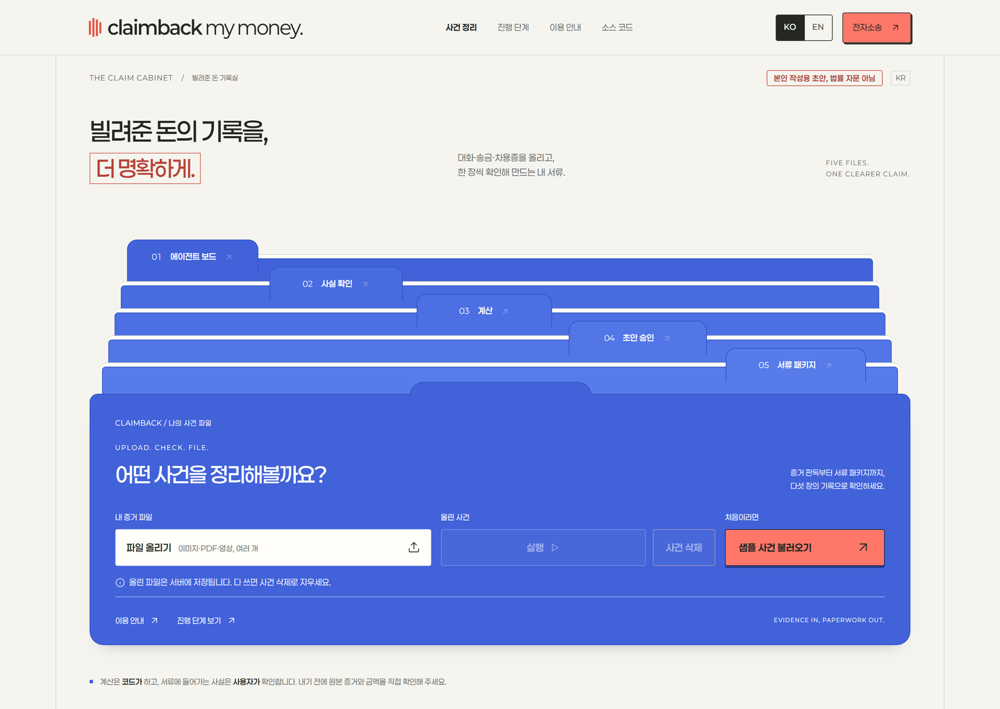
**Korean screen** (the default for Korean browsers).

</details>

Screenshots 01–08: `tools/readme_screenshots.py` against the backend in replay mode (no key). The two document pages are PDF renders from the live demo take, copied in with its `--doc` option. Logo: `assets/logo/` (`make_logo.py`). Video poster: `assets/demo/make_poster.py`.

## What it does

You lent a friend 5,000,000 won and got 1,000,000 back. ClaimBack-AI takes your chat screenshots, transfer receipts and IOU, and helps you prepare:

- a 내용증명 (certified demand letter) PDF,
- the 청구취지 / 청구원인 text to paste into the e-court payment-order form,
- a 갑호증 exhibit bundle (redacted copies, "갑 제N호증" marks) and an 증거목록 (evidence list).

Every fact in those documents is one you confirmed on screen. The AI never writes numbers or names into the documents directly.

## How it works

A rule-based coordinator runs role agents with two human checkpoints:

| Step | Agent | Model |
|---|---|---|
| Intake | records each file's SHA-256 and exhibit number | rules |
| Reading | reads each image with boxes; long screenshots are read in overlapping tiles | `muse-spark-1.2` (prompt `reader.v2`) |
| Vision | finds chat bubbles, profile pictures, stamps and signature boxes | `sam-3.1` |
| Fact organizing | proposes field values, each tied to the reading it came from; flags conflicts and asks questions | `muse-spark-1.3` (prompt `fact_organizer.v2`) |
| Privacy | burns account / ID / phone numbers out of the image pixels; checks the mask edges and flags anything it cannot confirm | rules |
| **Checkpoint 1** | you confirm or correct every value | you |
| Calculation | interest allocation, remaining principal, statutory rates | deterministic code |
| Drafting | writes fact sentences with **slots only** (`{{principal}}`, `{{quote:EX1:item10}}`) | `muse-spark-1.3` (prompt `drafter.v2`) |
| Verification | G1a no literal numbers/names, G3 every fact cites evidence, DRAFT no computed values or invented speech, NAMING no professional titles | rules |
| **Draft approval** | you approve or edit each sentence | you |
| Packaging | renders the documents from your confirmed values; G1b re-checks every PDF against them, per document | rules |

Model choices were measured, not guessed: `muse-spark-1.2` and `1.3` both matched ≥95% of amounts and dates on the sample set, and 1.2 had the shorter p95 latency (8.8 s vs 33.2 s), so 1.2 reads and 1.3 organizes and drafts (`reports/M4b.md`).

## Architecture

**User flow.** Start screen → upload your evidence (or load the sample case) → the agents run while the agent board shows each step → **Checkpoint 1**: confirm or correct every value on the fact-check sheet → calculation → **draft approval**: approve or edit each sentence → filing package: the demand-letter PDF, the exhibit bundle and evidence list, and the payment-order text to paste into the e-court form.

**Components.**

| Part | What it is | Where it runs |
|---|---|---|
| Screen | Zero-build vanilla JS, Korean and English (`frontend/`) | Served by the backend at `http://localhost:8000`. A copy in `docs/` is on GitHub Pages; without a backend it shows an offline notice and the demo video link |
| Backend | FastAPI (`backend/app/main.py`). Case API under `/api/cases` (contract: `specs/case-api-contract.md`). Cases are stored as files under `backend/data/cases/` (`CASES_DIR` overrides) | Your machine (uvicorn) |
| Coordinator and agents | A rule-based coordinator runs the role agents (`backend/app/agents/`: `intake`, `reader`, `vision`, `fact_organizer`, `privacy_guard`, `drafter`, `packager`) | Backend |
| Meta client | `backend/app/meta/client.py`: OpenAI Python SDK with base URL `https://api.meta.ai/v1`; `live`, `record` and `replay` modes; cost ledger and caps | Backend |
| Rules and documents | Draft rules and gates, calculation, pixel redaction (Pillow), PDFs (reportlab, pypdf) and the final check (`backend/app/services/`) | Backend |

**Where each Meta model runs.** All three run on the Meta Model API (Responses endpoint); nothing runs on our own compute. Muse Code was used to build the app and is not part of it at runtime.

| Model ID | What it does in the flow | Code |
|---|---|---|
| `muse-spark-1.2` | Reads each evidence image with bounding boxes; tall screenshots in overlapping tiles | `backend/app/agents/reader.py` |
| `sam-3.1` | Finds chat bubbles, profile pictures, stamps and signature boxes, used for redaction and the evidence views | `backend/app/agents/vision.py` |
| `muse-spark-1.3` | Organizes facts with links to the readings; drafts fact sentences with slots only | `backend/app/agents/fact_organizer.py`, `backend/app/agents/drafter.py` |

**Logs: matching the screen to real Meta calls.** The agent board shows each step with its model ID, latency and cost, and its header shows `Meta model calls: N · $X · live calls`. The case ID is shown on screen. Every call is also one line in the cost ledger (`META_LEDGER_PATH`, default `reports/cost_ledger.jsonl`) with `ts`, `run_id` (the case ID), `model`, `endpoint`, tokens, `latency_ms`, `cost_usd` and `status`. Count the lines with `"status": "completed"` (each call writes a `reserved` line first, which the app offsets); 37 early lines from the first spike have no `status` and also count as completed. The ledger does not store the provider's request ID.

**Hosting.** No hosted backend. GitHub Pages serves `docs/` (the screen without a backend, and the demo video). Run the backend locally to use the app.

**Keys.** The backend reads `MODEL_API_KEY` from its environment. The key never goes to the browser and is never committed: `.env` is git-ignored, and `tools/secret_scan.py` runs before every commit.

**Pre-existing and third-party.** The screen's visual style (layout, colours, Paperlogy font, folder-tab motif) is adapted from the owner's own earlier personal project 경매노트 (auctionnote), which predates the event. About a quarter of `frontend/case.css` (mirrored in `docs/case.css`) is copied from that project's stylesheet: the colour tokens and the header, folder-tab and cabinet rules (108 of its 435 non-trivial lines match, measured 2026-11-04). Apart from those lines, the code in this repo was written during the event (first commit 2026-11-02). Third-party libraries: FastAPI, Pydantic, uvicorn, the OpenAI Python SDK, `meta-sam-parser`, pypdf, reportlab, Pillow, cryptography, httpx and python-multipart, plus pytest and Playwright for tests. Fonts: NanumGothic and Paperlogy (OFL). `backend/app/templates/ca_sc100_blank.pdf` is the California Judicial Council SC-100 form. Everything else was built during the hackathon (see "How it was built").

## Safety by design

- No legal evaluation: no win predictions, no "you can claim" judgments, no legal labels on what people said.
- The AI writes slots, not values. Values come from your confirmed facts and the deterministic calculator; a verifier rejects literal numbers, computed values posing as agreements, and speech the evidence does not quote.
- Redaction is burned into image pixels before any PDF is built. If the checker cannot confirm a redaction, the image is flagged "확인 필요" and left out of the exhibit bundle until you confirm it.
- Sample evidence is synthetic and marked "SAMPLE / 데모용".

## Quick start (no key needed)

Needs Python 3.11 or later (tested with 3.12.10). Replay mode runs the sample case from recorded Meta model responses, so no API key is needed.

Windows (PowerShell):

```powershell
python -m venv .venv
.\.venv\Scripts\python.exe -m pip install -r requirements.txt
cd backend
$env:META_MODE = "replay"
..\.venv\Scripts\python.exe -m uvicorn app.main:app --port 8000
```

macOS or Linux:

```bash
python3 -m venv .venv
.venv/bin/python -m pip install -r requirements.txt
cd backend
export META_MODE=replay
../.venv/bin/python -m uvicorn app.main:app --port 8000
```

Open `http://localhost:8000` (or `http://localhost:8000/?lang=en` for the English screen; the **KO / EN** switch in the header changes it any time). Press **샘플 사건 불러오기** (**Load the sample case**); the case runs on its own, then follow the two checkpoints.

## Run with your own Meta Model API key

The app reads its settings from environment variables; it does not load a `.env` file. [`.env.example`](.env.example) lists them. Never commit your key. In PowerShell:

```powershell
cd backend
$env:META_MODE = "live"
$env:MODEL_API_KEY = "<your Meta Model API key>"                   # from dev.meta.ai
$env:META_LEDGER_PATH = "$env:TEMP\claimback_cost_ledger.jsonl"    # absolute path to your own cost ledger
$env:META_LEDGER_INIT = "1"                                        # first run only: creates that ledger
..\.venv\Scripts\python.exe -m uvicorn app.main:app --port 8000
```

macOS or Linux:

```bash
cd backend
export META_MODE=live
export MODEL_API_KEY="<your Meta Model API key>"
export META_LEDGER_PATH="${TMPDIR:-/tmp}/claimback_cost_ledger.jsonl"
export META_LEDGER_INIT=1
../.venv/bin/python -m uvicorn app.main:app --port 8000
```

- Models: `muse-spark-1.2` (reading), `muse-spark-1.3` (fact organizing, drafting) and `sam-3.1` (regions), all Standard tier.
- Every call's cost goes into your ledger. A run stops before it would exceed `META_RUN_CAP_USD` (default $2), and the ledger total is capped by `META_TOTAL_CAP_USD` (default $100). Use your own ledger path as above, so your runs are not counted against the spend already recorded in this repo's `reports/cost_ledger.jsonl`.
- Upload your own evidence on the start screen, or the English SAMPLE evidence used in the demo video: [`submission/demo-evidence/`](submission/demo-evidence/).

## Recorded outputs and traces

For what you cannot rerun without a key:

- [`backend/tests/fixtures/meta/`](backend/tests/fixtures/meta/): 109 recorded Meta Model API responses. Replay mode (the default) serves them, so the Korean sample case and the tests run end to end with no key.
- [`reports/cost_ledger.jsonl`](reports/cost_ledger.jsonl): every live call the app made during development, with model, tokens, latency and cost. As of 2026-11-04: 808 completed calls ($5.08), plus 37 lines from the first spike written before the ledger had a `status` field ($0.21), so $5.29 in all.
- [`reports/M7-live-check.md`](reports/M7-live-check.md) (Korean): an end-to-end run of the sample case on the live API.
- The demo video's take: 34 live calls for $0.1887, the ledger lines with `run_id` `case_e91e96da3a3c` (2026-11-03 16:42 UTC). The generated document pages are in `assets/screenshots/09-*.png`, and how it was recorded is in [`submission/demo-video-production.md`](submission/demo-video-production.md) (Korean).

## Tests

```powershell
cd backend
..\.venv\Scripts\python.exe -m pytest -q          # offline, replay mode, no key
cd ..
.\.venv\Scripts\python.exe -m pip install -r requirements-dev.txt
.\.venv\Scripts\python.exe -m playwright install chromium
.\.venv\Scripts\python.exe -m pytest -q e2e       # Playwright against the stub server
# against the real backend: start uvicorn as above, then set E2E_BASE_URL=http://127.0.0.1:8000
```

## How it was built

- Milestone briefs: `specs/tasks/`. Muse Code reports: `reports/M*.md`, `reports/INT-*.md`. Claude Code reviews (two independent reviewers per milestone, cross-checked): `reports/*-review.md`.
- Every live Meta API call made by the app during development is in `reports/cost_ledger.jsonl`.
- The screen's visual style (layout, colours, Paperlogy font, folder-tab motif) is adapted from the owner's earlier project 경매노트 (auctionnote), which predates the hackathon; part of `frontend/case.css` follows its stylesheet. The case flow, the agents, the screen logic and the English screen were built during the hackathon.

## Known limits

- Korean track only in this version (the US SC-100 path is partial). The screen is in Korean and English; case content and the documents stay in Korean because they are filed in Korean courts, and a few backend messages (conflict notes, hold reasons, check findings) are shown in Korean on the English screen.
- Video evidence is stored and hashed, but frame reading is not in the case flow yet (it produced duplicates and timestamp drift in testing; see `reports/M4b-review.md`).
- Reading boxes on very tall screenshots are still approximate; the privacy step refines boxes from the image pixels and flags anything it cannot confirm.
- The draft-rule checker is word-based; it can still block a few harmless sentences you type yourself (for example a promise phrase next to a date slot). Review your own edits before approving (`reports/INT-3c-review.md`).
- Video evidence goes into the exhibit list as "submit the file separately" and is not redacted; check it yourself before filing.

---

## 🔔 Notice

ClaimBack-AI는 본인이 직접 소송 서류를 준비할 때 쓰는 무료 정리 도구입니다. 법률 자문을 제공하지 않으며, 서류에 들어가는 사실은 모두 사용자가 확인한 내용입니다. 법률 상담은 대한법률구조공단(132)이나 변호사에게 받으세요.

ClaimBack-AI is a free self-help tool for organizing your own evidence and filling standard court forms. It does not provide legal advice. Every fact in the documents is confirmed by you. For help, contact your court's self-help center or a small claims advisor.

---

## 📄 License

- Source code and generated sample files: MIT (see `LICENSE`).
- Bundled fonts (`backend/app/templates/fonts/NanumGothic-*.ttf`): SIL Open Font License 1.1 (see `backend/app/templates/fonts/OFL.txt`).
- Screen fonts (`frontend/fonts/Paperlogy-*.woff2`, mirrored in `docs/fonts/`): SIL Open Font License 1.1 (see `frontend/fonts/OFL-Paperlogy.txt` and `frontend/fonts/README.md`).
- Logo (`assets/logo/`): made for this project from the site header; its letters are outlines of Paperlogy (OFL 1.1), which the OFL allows in logos and images.
- Demo video (`docs/demo/`): made for this project; its music and sound effects are synthesized in code, with no third-party audio.
- `backend/app/templates/ca_sc100_blank.pdf`: a California Judicial Council Form SC-100 file included unmodified for form-filling; it is not covered by the MIT license above.
